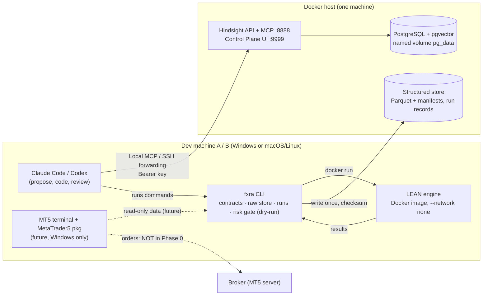

# Architecture

## Components and trust zones

| Component | Owns | Does not own |
|---|---|---|
| LEAN | Strategy execution in backtest and paper modes, fills, portfolio statistics | Raw data provenance, approval decisions |
| `fxra` | Data contracts, raw store, run records, risk gate, LEAN invocation | Strategy logic |
| Structured store | Prices, quotes, spreads, swaps, symbol specs, fills, account snapshots, run metrics | Narrative and rationale |
| Hindsight | Hypotheses, decisions, results summaries (with `run_id`), postmortems, operating lessons | Any number used in a calculation |
| Claude / Codex | Research notes, code, reviews, candidate strategies (as pull requests) | Promotion, live config, order sending |
| Owner (human) | Approval at every promotion gate, broker account, secrets | — |

## Data flow

1. **Ingest.** A market data adapter (`fxra.adapters.MarketDataAdapter`) fetches bars or quotes, converts times to UTC, and returns contract-shaped tables. `fxra.rawstore.write_partition` writes one immutable partition per source, symbol, resolution and UTC day, with a manifest (checksum, row count, adapter version, source timezone, git commit, writer host).
2. **Prepare.** *(Phase 1)* An export step converts raw partitions into LEAN's data format under `data/lean/`, and records which manifests it used.
3. **Run.** `fxra backtest <research.toml>` writes a run record (`runs/<run_id>/run.json`: code commit, config hash, data source and range, cost assumptions, split). It then runs LEAN in the pinned image with no network and collects the statistics and artifacts into the same folder.
4. **Remember.** An agent or a human writes a short Hindsight memory: the hypothesis, the `run_id`, what happened, and the decision. The memory points to the run. It never copies the numbers as the source of truth.
5. **Gate.** *(Phase 2 and later)* Order intents from paper or demo strategies go through `fxra.risk.evaluate` before any execution adapter. Phase 0 has only `DryRunExecution`, which writes to a journal and sends nothing.

## Permissions

| Actor | Read | Write | Never |
|---|---|---|---|
| Coding agent | repo, structured store, Hindsight bank; reviewed MT5 read tools | branches and PRs, `runs/`, `experiments/`, Hindsight memories; future demo mutation proposals through D-28 confirmation | push to `main` for strategy/live/risk config, change `risk.toml` or the kill switch, hold broker credentials, bypass confirmation/risk checks, execute live orders |
| `fxra` ingestion | broker data API (read-only login when MT5 arrives) | `data/raw` (one writer host per source) | overwrite a partition |
| LEAN container | mounted algorithm (read-only), data (read-only) | its results folder | network access in backtests |
| Hindsight server | its database | its database, `/backups` | public Internet exposure |
| Owner | everything | approvals, secrets, risk limits | — |

## Deployment

- D-27 selects this development machine as the primary memory host: both machines use its Hindsight service and a separate ai-memory backend. Services bind to loopback; the second machine connects through authenticated SSH forwarding with verified host identity. Its existing Hindsight database is preserved as a standby/archive and leaves the shared write path during cutover. Actual histories remain separate until cutover acceptance; archive synchronization does not replicate live writes. See [topology and cutover](memory-topology.md), `infra/hindsight/README.md` and the verification section in `docs/memory-and-simulation.md`.
- In Phase 0, the structured store lives on the machine that ingests (single writer per source). Other machines get read-only copies (Phase 1 decides how: rsync, Syncthing, or a shared read-only mount; see `decisions.md` Q-08).
- Dev machines run LEAN locally in Docker. Results stay in `runs/` on the machine that ran them, and summaries go to Hindsight.

## What is deliberately absent

D-28 permits reviewed order-capable integrations with read-only defaults and a
trusted confirmation service for future demo mutations. Neither that service nor
an MT5 execution adapter is implemented. See `security.md` for required previews,
single-use authorization, risk checks, reconciliation and acceptance tests.

- A LEAN–MT5 brokerage or data adapter. None is chosen or verified; this is research item B-12.
- A vector database or RAG system of our own. Hindsight already provides recall.
- Automated optimization that reports in-sample results as evidence.
- Any LLM in the per-tick decision path.

## Memory layers and simulation foundation

Development context and Claude/Codex handoffs use a separately scoped ai-memory backend (D-26 exact-artifact review and local installation passed; real client/cross-machine acceptance remains; see local-memory-mcp.md). Hindsight remains the research/character memory system. There is no bridge that copies one layer into the other. Canonical project decisions stay in Git. Both layers have one primary host under D-27; unavailable-primary writes fail closed rather than falling back to a divergent local backend.

`fxra.simulation` adds a local SQLite controller database, separate from the market-data Parquet store. It atomically owns the event journal, independent life/employment state, four separate financial account types, evidence/status revisions, immutable personality, departure snapshots and final outputs. It has no dependency on execution adapters. It neither promotes strategies nor relaxes the existing risk gate.

Personal and professional narrative events are queued durably and retained into Hindsight through a trusted document transport. The registry selects exact immutable documents for one identity and a host-selected simulation cutoff. No character gets bank-wide recall, derived memories, ai-memory access, host credentials or filesystem tools. Shared tasks/skills/knowledge have explicit evidence and status. Successor messages require a separate timed publication event; private life reviews remain archived.

The implemented boundary is an allowlisted tool dispatcher. A character LLM runner/OS sandbox is not part of this increment; any future runner must enforce the documented no-shell/no-filesystem/no-raw-MCP deployment. `simulation-demo` demonstrates the lifecycle without an LLM, market data, MT5 or LEAN. See [memory and simulation](memory-and-simulation.md) for policy, clocks, expiry scheduling and restore procedures.
