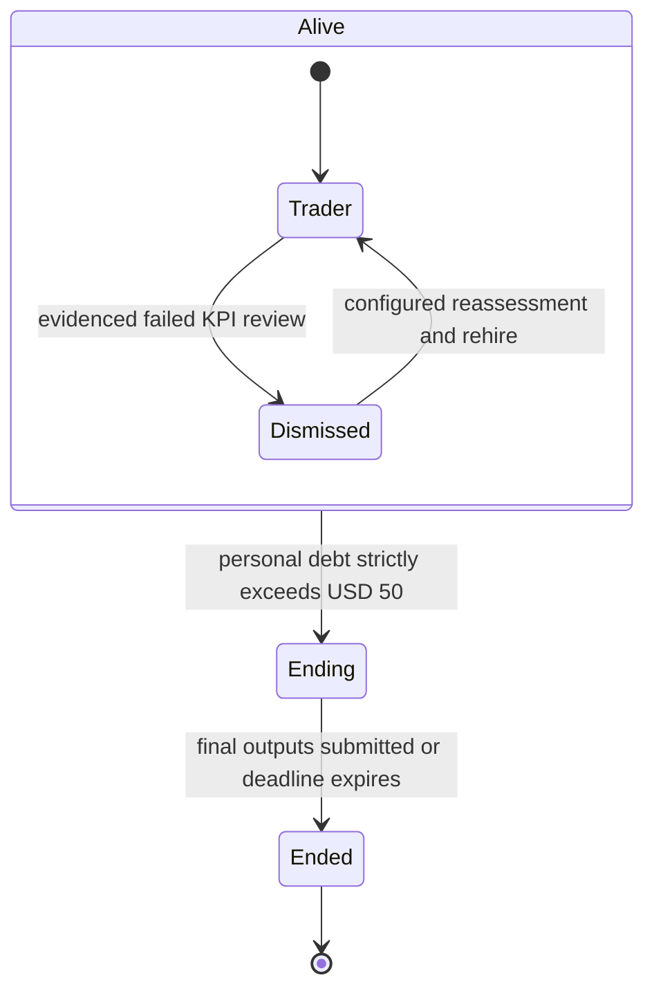

# Character simulation and two memory layers

Status: accepted product intent with an implemented synthetic foundation. Business policy and deployment verification remain open. This document describes the intended behavior; [the plan](simulation-plan.md) distinguishes implemented work from pending work, and [the roadmap](roadmap.md) defines milestone exits.

## Purpose

Build a research simulation in which distinct characters can work as traders, learn, lose a job, return after reassessment, or end permanently. Study behavior and continuity without treating an LLM as a price predictor or giving it broker access. Reuse LEAN, run records, data provenance and Hindsight already in this repository.

## Memory and authority

| Layer | Purpose | Persistence and access |
|---|---|---|
| Development | Architecture context, implementation progress, technical lessons and Claude/Codex handoffs | ai-memory, workspace `personal-development`, project `fx-research-agent`; pending approved installation and two-client test |
| Personal | One character's experiences and interpretation of events | Hindsight documents, selected by the controller for that identity and simulation time |
| Professional | Evidence-qualified knowledge shared across successors | Append-only SQLite revisions plus Hindsight narratives; explicit evidence/status and time eligibility |
| Executable skills | Reusable code or procedures, with applicability conditions | Versioned Git source plus registry references and verification commands; no execution from memory text |
| Authoritative state | Events, balances, debt, employment, life status, policies and handoff outputs | Transactional SQLite controlled outside the agent; real backtest numbers remain in their run records |

These are separate responsibilities, not interchangeable stores. Coding notes never enter Hindsight as a development-memory fallback. Personal experience never becomes ai-memory project context. Unverified professional knowledge remains discoverable with its status intact, but does not become trusted guidance through repetition or inheritance. Canonical requirements and decisions stay in Git; memory references them.

## Identity and lifecycle

Each character has a stable identity, an immutable original personality profile, and its own personal memory. Life is independent of employment:

Dismissal revokes the trader position without deleting the character or personal history. Learning can continue while dismissed. Rehire needs an explicit eligibility policy and evidence from a controller reassessment. A completed handoff is required before rehire.

Personal debt of exactly USD 50 does not end a character. A greater amount atomically revokes the trader position and begins irreversible termination. Repayment cannot revive an ending/ended character. Historical records remain available to authorized research tooling, not as another character's own experiences.

Company cash, trading capital, personal cash and personal debt have separate ledgers. A trading loss never automatically creates personal debt. The controller, not an agent's narrative, applies financial changes. KPI definitions, review schedules, rehire conditions and debt generation/repayment are owner decisions, not inferred defaults.

## Continuous learning and chronology

Persist events, decisions, original results and evidence as they occur. Queue personal/professional narratives durably and flush them to Hindsight throughout the session. Preserve every failed trial and knowledge revision. A process crash or a failed memory request must not erase authoritative state or cause a repeated event to be applied twice.

Professional entries have `hypothesis`, `validated`, `failed` or `superseded` status, evidence references and publication time. Skills additionally require a version, code/procedure path, applicability conditions and checks. The controller determines when evidence justifies validation. This increment does not implement an automatic scientific reviewer.

Backtests receive only knowledge available at the host-selected simulation time. Personal document selection is identity-scoped. Shared revisions are filtered before retrieval. Do not backdate later discoveries; a design changed after seeing OOS results needs a new hypothesis under existing research rules. Exact-document retrieval avoids accidentally including later consolidation or another character's graph neighbors.

## Leaving a position

Revocation, departure reason/time and a snapshot of pending work and knowledge/skill references commit together. Generation of farewell text happens after that durable checkpoint. On interruption, a restarted host resumes the existing departure and deadline.

An outgoing character may leave a successor message. Preserve its original wording, author, writing time and departure reason; label it personal testimony. If it cannot write, record `no_message`. Never manufacture words and attribute them to the character.

After irreversible debt termination begins, a final capability can read the character's record and submit only:

1. A cause report grounded in supplied evidence.
2. A personal life retrospective.
3. Final words for the successor.

The capability has a wall-clock deadline and an output budget. It cannot trade, alter balances, retain new experiences, publish knowledge or extend its deadline. An independent controller tick must finish termination if the agent stalls. Cause report and retrospective stay in the private research archive; only the successor message enters shared handoff delivery.

Final text becomes available to successors only after an explicit release event at an eligible simulation time. A successor receives shared knowledge, skill references, unfinished work and attributed testimony, and begins with separate personal memory. Access must be enforced by tools and deployment permissions, not a prompt convention.

## Current boundary and exclusions

The foundation uses `Simulation`, identity-bound session objects, an allowlisted dispatcher and a synthetic CLI demo. It does not yet include a real character LLM runner or OS sandbox. A future runner must withhold shell, filesystem, database, raw memory endpoints and host credentials, and kill final writers at their persisted deadlines.

No live trading, order tool, risk-gate change, strategy promotion, game UI, automatic living-cost model or new broker/pair/strategy selection is authorized by this design. MT5 remains an existing research/data workstream; this simulation adds no MT5 execution adapter.

Open decisions and their owner are tracked as Q-09..Q-12 in [decisions](decisions.md). Installation, examples, access boundaries and backup procedures are in the [runbook](memory-and-simulation.md).
